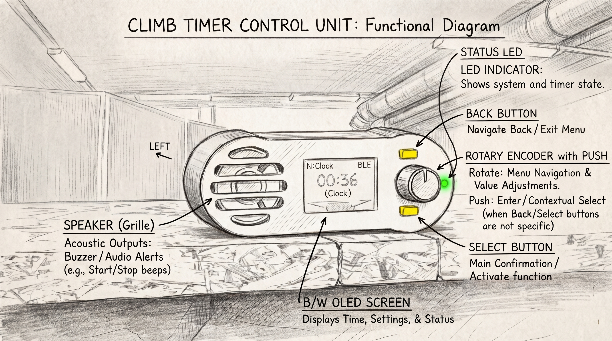
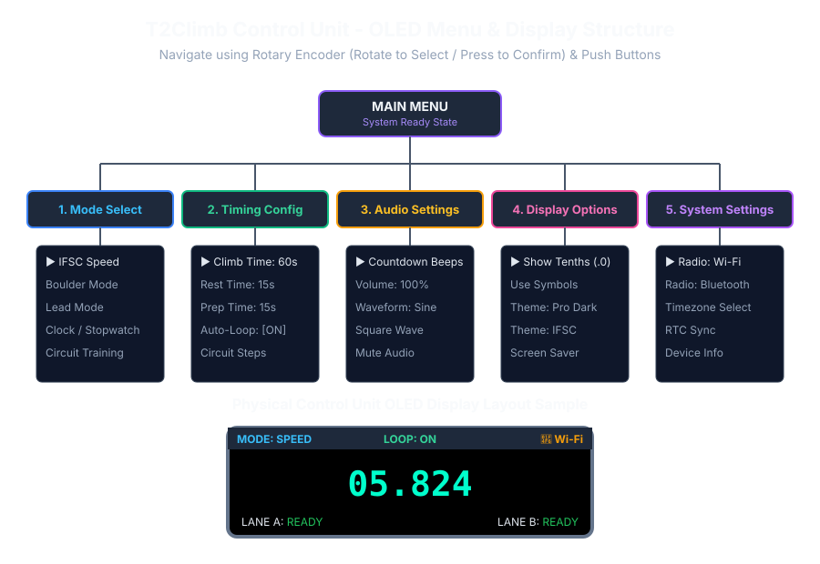

# Ajastinyksikkö & Painikkeet

T2Climb-ohjausyksikköä voidaan käyttää täysin itsenäisesti ilman puhelinta tai tietokonetta. Yksikössä on kirkas OLED-näyttö, korkeadesibelinen äänisummeri, säätönuppi sekä kestävät fyysiset painikkeet.

---

## 🧭 Pikanavigointi

- [Fyysisten painikkeiden toiminnot](#fyysisten-painikkeiden-toiminnot)
- [Säätönupin käyttö](#saatonupin-kaytto)
- [OLED-näytön lukeminen](#oled-nayton-lukeminen)
- [Laitteen asennus ja virta](#laitteen-asennus-ja-virta)

---

## Fyysisten painikkeiden toiminnot

Etupaneelin painikkeilla hallitset ajastinta helposti mankkaantuneillakin käsillä:

| Painike | Toiminto | Mitä tapahtuu painettaessa |
| :--- | :--- | :--- |
| **Button 0 (Action / Start)** | Start / Eteenpäin | Käynnistää ajastuksen, valmisteluajan tai siirtää seuraavaan vaiheeseen. |
| **Button 1 (Reset)** | Reset | Nollaa kellon takaisin alkuvalmiustilaan. |
| **Button 2 (Lane A / Top A)** | Rata A Top / Väliaika | Pysäyttää Radan A (vasen) kun kiipeilijä saavuttaa topin, tai tallentaa Väliajan A. |
| **Button 3 (Lane B / Top B)** | Rata B Top / Väliaika | Pysäyttää Radan B (oikea) kun kiipeilijä saavuttaa topin, tai tallentaa Väliajan B. |

---

## Säätönupin käyttö

Näytön vieressä oleva kierrettävä ja painettava nuppi mahdollistaa asetusten muuttamisen nopeasti:

- **Kierrä vasemmalle / oikealle**: Selaa valikoita (lajit, äänet, ajat).
- **Lyhyt painallus**: Avaa alivalikon tai vahvistaa arvon.
- **Aikojen säätö**: Myötäpäivään lisää sekunteja, vastapäivään vähentää sekunteja.

---

## OLED-näytön lukeminen

Korkeakontrastinen näyttö näkyy selkeästi kaukaakin kiipeilyseinältä.

### Näytön osiot

1. **Yläpalkki**:
    - Näyttää aktiivisen lajin (`SPEED`, `BOULDER`, `LEAD`, `CIRCUIT`, `CLOCK`).
    - Kertoo kiertotilan (`LOOP: ON` tai `OFF`).
    - Yhteyskuvake (`📶 Wi-Fi` tai `ᛒ BLE`).
2. **Pääaikanäyttö**:
    - Suuret numerot näyttävät jäljellä olevan tai kuluneen ajan.
3. **Ratojen tilamerkit**:
    - `READY`: Kiipeilijät lähtölevyillä, valmiina.
    - `RACING`: Kello käynnissä.
    - `WIN`: Kiipeilijä kosketti toppilevyä (voittoaika lukittu).
    - `FALSE`: Varaslähtö rekisteröity.
    - `FALL`: Kiipeilijä pudonnut.

---

## Laitteen asennus ja virta

- **Virtalähde**: Toimii millä tahansa tavallisella USB-C-johdolla (varavirtalähde tai pistorasiamuuntaja).
- **Anturien liittäminen**: Kytke jalkalevyt ja yläkosketuslevyt laitteen takapaneelin anturiliittimiin ennen virran kytkemistä.
- **Äänitesti**: Käännä nuppi äänivalikkoon ja testaa äänenvoimakkuus ennen treenin alkua.
