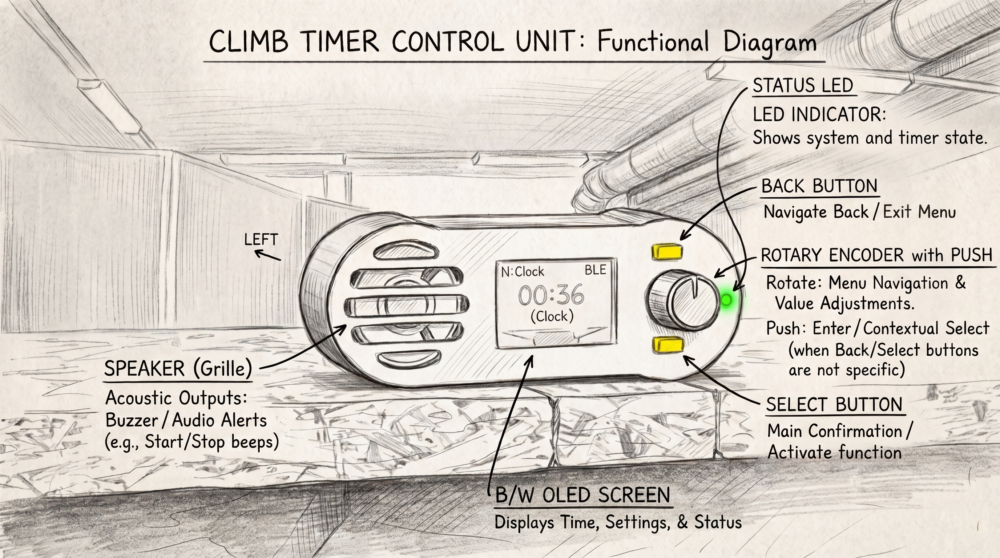
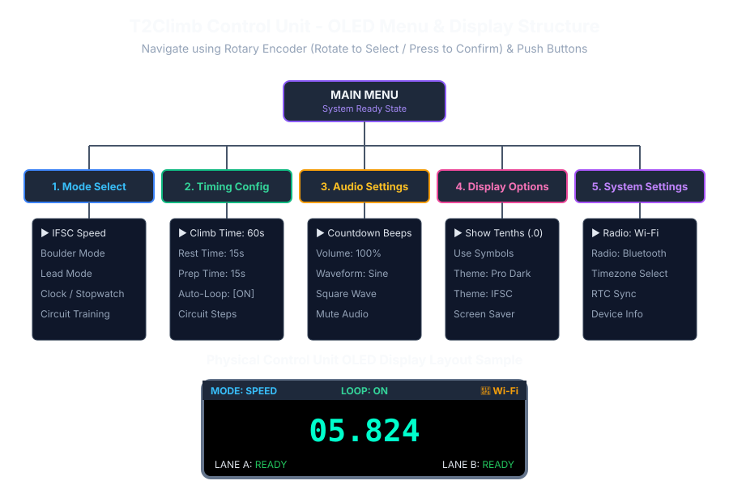

# Hardware Station & Physical Controls

The T2Climb Station can be used completely standalone without a phone or laptop. It features a bright OLED display, high-decibel audio buzzer, rotary navigation knob, and tactile push buttons.

---

## 🧭 Quick Navigation

- [Physical Button Functions](#physical-button-functions)
- [Rotary Knob Navigation](#rotary-knob-navigation)
- [Reading the OLED Screen](#reading-the-oled-screen)
- [Station Setup & Power](#station-setup-power)

---

## Physical Button Functions

The front panel buttons give you instant control even with chalky fingers:

| Button | Function | What Happens When Pressed |
| :--- | :--- | :--- |
| **Button 0 (Action / Start)** | Start / Advance | Starts countdown, triggers prep timer, or advances interval. |
| **Button 1 (Reset)** | Reset | Clears clock back to initial starting state. |
| **Button 2 (Lane A / Top A)** | Lane A Stop / Split | Stops Lane A (Left Lane) when athlete hits top, or logs Split A. |
| **Button 3 (Lane B / Top B)** | Lane B Stop / Split | Stops Lane B (Right Lane) when athlete hits top, or logs Split B. |

---

## Rotary Knob Navigation

The clickable knob next to the screen lets you adjust settings without connecting a smartphone:

- **Rotate Left / Right**: Scroll through menu choices (Mode, Volume, Timers).
- **Short Press**: Enter a sub-menu or confirm a value.
- **Adjusting Times**: Turn clockwise to increase seconds, counter-clockwise to decrease seconds.

---

## Reading the OLED Screen

The OLED screen is high-contrast and readable from across the training area.

### Screen Elements
1. **Header Bar**:
   - Shows the active discipline (`SPEED`, `BOULDER`, `LEAD`, `CIRCUIT`, `CLOCK`).
   - Shows loop status (`LOOP: ON` or `OFF`).
   - Shows connection icon (`📶 Wi-Fi` or `ᛒ BLE`).
2. **Main Number Readout**:
   - High-visibility digits showing time remaining or elapsed time.
3. **Lane Status Badges**:
   - `READY`: Athletes on pads, ready to start.
   - `RACING`: Timer is actively running.
   - `WIN`: Climber touched top pad (winning time locked).
   - `FALSE`: False start detected on start pad.
   - `FALL`: Climber fell off route.

---

## Station Setup & Power

- **Power Input**: Powered via standard USB-C cable (power bank or wall adapter).
- **Sensor Connections**: Plug start foot pads and top finish pads into the rear sensor ports before powering on.
- **Sound Check**: Rotate knob to Sound settings to test volume before your workout.
