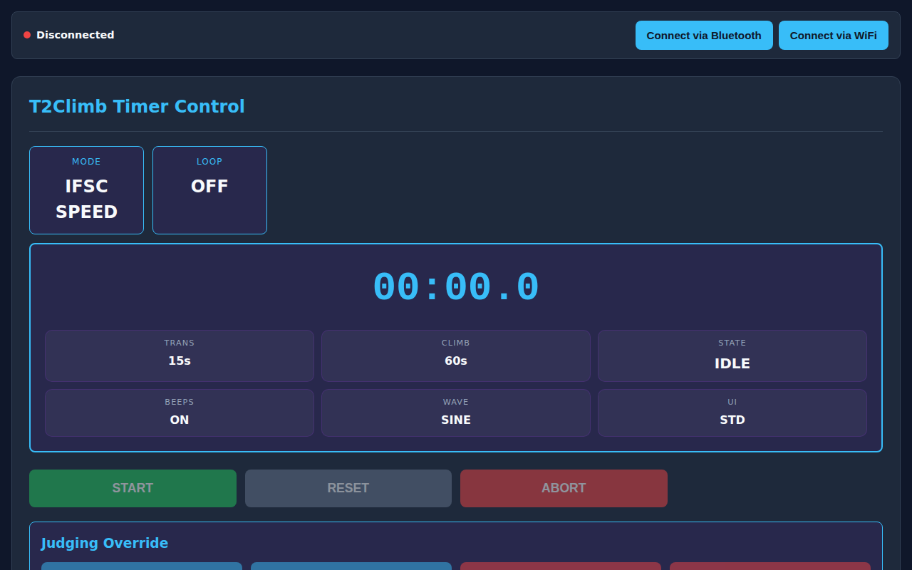

# Selainsovelluksen Ohje

T2Climb-selainsovellus (`timer-ctrl`) mahdollistaa ajastimen ohjaamisen, harjoitusaikojen säätämisen sekä suoritusaikojen seuraamisen miltä tahansa älypuhelimelta, tabletilta tai tietokoneelta.

---

## 📱 Pikanavigointi

- [Ajastimeen yhdistäminen](#ajastimeen-yhdistaminen)
- [Päänäytön toiminnot](#paanayton-toiminnot)
- [Aikojen ja äänien säätäminen](#aikojen-ja-aanien-saataminen)
- [Näyttöasetukset ja teemat](#nayttoasetukset-ja-teemat)

---

## Ajastimeen yhdistäminen

Sovelluskaupasta ei tarvitse asentaa mitään. Avaa sovellus Chrome-, Edge- tai Safari-selaimella:

1. **Bluetooth (Suositus puhelimelle)**:
    - Napauta **Connect via Bluetooth**.
    - Valitse T2Climb-laite Bluetooth-ikkunasta.
    - Yhteys muodostuu heti ilman salasanoja tai Wi-Fi-asetuksia.
2. **Wi-Fi**:
    - Yhdistä puhelimesi T2Climb-tukiasemaan (tai samaan hallin verkkoon).
    - Napauta **Connect via WiFi**.

---

## Päänäytön toiminnot

Päänäytöltä ohjaat harjoitusta vaivattomasti:

- **Suuri aikanäyttö**: Näyttää jäljellä olevan ajan (laskuri) tai kuluneen ajan (sekuntikello / nopeuskiipeily).
- **Lajimerkki**: Kertoo valitun tilan (`Speed`, `Boulder`, `Lead`, `Circuit`, `Clock`).
- **Toimintopainikkeet**:
    - **START / TOISTA / TAUKO / JATKA**: Käynnistää ajastimen tai sekuntikellon. Boulder- ja Intervallit-tiloissa painikkeen painaminen suorituksen aikana asettaa kellon tauolle (TAUKO), ja uusi painallus jatkaa suoritusta (JATKA).
    - **RESET**: Pysäyttää kellon ja palauttaa alkuvalmisteluun.
    - **ABORT**: (Nopeuskiipeily) Keskeyttää lähdön välittömästi.
    - **FINISH**: (Boulder / Lead) Päättää kiipeilyn heti ja siirtyy lepojaksolle.
- **Tuomaripainikkeet** *(Nopeuskiipeily)*:
    - **WINNER A / WINNER B**: Merkitsee radan voittajaksi.
    - **FALL A / FALL B**: Merkitsee putoamisen.
- **Visuaalinen edistymispalkki**: Havainnollistaa kuluvan vaiheen ja seuraavat intervallit.

---

## Aikojen ja äänien säätäminen

Avaa **⚙️ Configuration** -painike alareunasta. Muutokset päivittyvät ajastimelle heti:

### 1. Kiipeilyasetukset

- **Climb Mode**: Valitse Speed, Boulder, Lead, Clock tai Circuit.
- **Climb Duration**: Kiipeilyaika sekunteina.
- **Transition Duration**: Lepoaika tai siirtymäaika sekunteina.
- **Initial Prep Duration**: Lähtölaskenta-aika ennen 1. suoritusta.
- **Enable Auto-Loop**: Jatkuva kierto (Kiipeily ➔ Lepo ➔ Kiipeily).

### 2. Ääniasetukset

- **Countdown Beeps**: Varoituspiippaukset päälle tai pois.
- **Audio Waveform**: **Warm Sine** (pehmeä sisähalliin) tai **Sharp Square** (kantava terävä ääni).
- **Audio Volume**: Äänenvoimakkuus 0 % – 100 %.

---

## Näyttöasetukset ja teemat

Mukauta sovelluksen ulkoasua:

- **Show Tenths**: Näyttää sekunnin kymmenykset (`12.4s`).
- **UI Theme**: **Pro Dark** (korkeakontrastinen teema salille) tai **IFSC Official Colors**.
- **Sync System Time**: Napauta **🕒 Sync System Time with Browser** asettaaksesi ajastimen kellon puhelimen aikaan.
