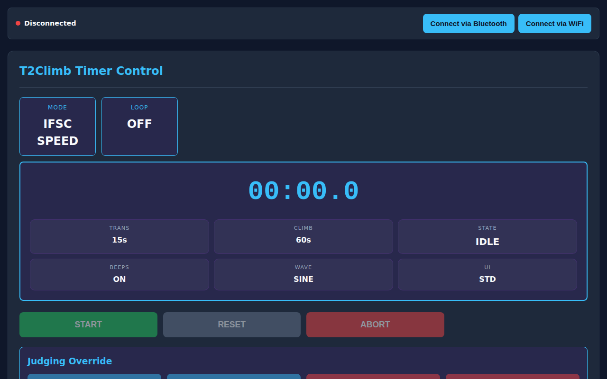

# Web App & Remote Control Guide

The T2Climb Web App (`timer-ctrl`) allows you to control the timer, adjust training intervals, and view live results directly from any smartphone, tablet, or laptop.

---

## 📱 Quick Navigation

- [Connecting to the Timer](#connecting-to-the-timer)
- [Main Screen Controls](#main-screen-controls)
- [Configuring Intervals & Sound](#configuring-intervals-sound)
- [Display Options & Themes](#display-options-themes)

---

## Connecting to the Timer

You don't need to install any app store software. Simply open the web page in Chrome, Edge, or Safari:

1. **Bluetooth (Recommended for Phone)**:
    - Tap **Connect via Bluetooth**.
    - Select your T2Climb timer from the Bluetooth device dialog.
    - You are connected immediately without needing Wi-Fi or entering passwords.
2. **Wi-Fi**:
    - Join the T2Climb Wi-Fi network (or connect both devices to the gym network).
    - Tap **Connect via WiFi**.

---

## Main Screen Controls

The main display gives you full control of the current climb session:

- **Large Timer Display**: Shows active time remaining (countdown) or elapsed time (stopwatch / speed).
- **Mode Badge**: Shows current discipline (`Speed`, `Boulder`, `Lead`, `Circuit`, `Clock`).
- **Control Buttons**:
    - **START / PLAY / PAUSE / RESUME**: Starts the countdown or stopwatch. In Boulder and Circuit modes, clicking this button while running pauses the timer, and clicking again resumes the workout.
    - **RESET**: Stops the clock and resets back to the initial preparation state.
    - **ABORT**: (Speed mode) Halts a false start or race attempt immediately.
    - **FINISH**: (Boulder / Lead) Ends the current attempt early and moves to the rest period.
- **Judge Overrides** *(Speed Mode)*:
    - **WINNER A / WINNER B**: Manually triggers a win for either lane.
    - **FALL A / FALL B**: Marks a fall for either lane.
- **Visual Progress Bar**: Shows current phase (Prep, Climb, Rest) and previews upcoming intervals.

---

## Configuring Intervals & Sound

Tap **⚙️ Configuration** at the bottom to adjust your session settings. Changes take effect on the timer immediately:

### 1. Climb Settings

- **Climb Mode**: Switch between Speed, Boulder, Lead, Clock, and Circuit.
- **Climb Duration**: Time in seconds for the climbing phase.
- **Transition Duration**: Time in seconds for rest between attempts.
- **Initial Prep Duration**: Warning countdown before the first attempt starts.
- **Enable Auto-Loop**: Check to continuously repeat intervals (Climb ➔ Rest ➔ Climb).

### 2. Audio & Volume

- **Countdown Beeps**: Turn audio beeps on or off.
- **Audio Waveform**: Choose **Warm Sine** for indoor gyms or **Sharp Square** for loud, noisy areas.
- **Audio Volume**: Slider from 0% (silent) to 100% (maximum volume).

---

## Display Options & Themes

Customize how the timer looks on your screen:

- **Show Tenths**: Displays tenths of seconds (e.g. `12.4s`).
- **UI Theme**: Switch between **Pro Dark** (high contrast for outdoor/bright gyms) and **IFSC Official Colors**.
- **Sync System Time**: Tap **🕒 Sync System Time with Browser** to update the timer box's clock to your exact phone time.
