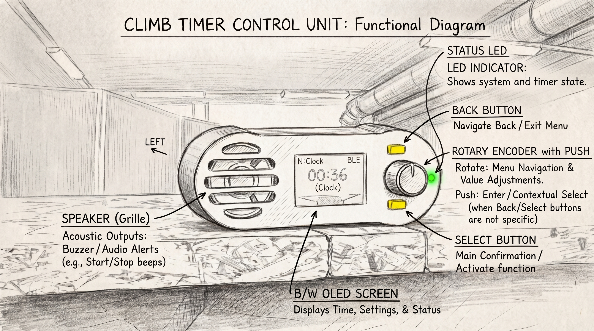

# T2Climb Ajastin — Kiipeilijän Käyttöohje

Tervetuloa **T2Climb Ajastimen Käyttöohjeeseen**! Suunniteltu kiipeilijöille, valmentajille, kiipeilyhalleille ja reitintekijöille. T2Climb tekee intervalliharjoittelusta, kisojen pyörittämisestä sekä virallisen IFSC-muotoisen nopeus- ja reittikiipeilyn ajanotosta vaivatonta.

---

## ⚡ 1 minuutin Pikaopas

### 1. Kytke virta ajastimeen
Liitä T2Climb-ohjausyksikkö USB-C-virtalähteeseen tai varavirtalähteeseen. OLED-näyttö käynnistyy ja siirtyy oletusnäkymään.

### 2. Yhdistä puhelimesi
Avaa T2Climb-selainsovellus älypuhelimellasi:
- Napauta **Connect via Bluetooth** yhdistääksesi laitteeseen heti ilman Wi-Fi-verkkoja tai salasanoja, tai
- Yhdistä laitteen luomaan Wi-Fi-verkkoon ja valitse **Connect via WiFi**.

### 3. Valitse laji ja aloita!
Valitse kiipeilylaji sovelluksen yläreunasta tai pyöritä ajastinyksikön säätönuppia:
- ⚡ **[Nopeuskiipeily](speed.md)**: Virallinen IFSC 15m nopeuskiipeilyn ajanotto, varaslähdön tunnistus ja yläkosketuslevyt.
- 🧗 **[Boulder](boulder.md)**: Ajastetut kiipeily- ja lepointervallit, automaattiset äänimerkit ja 1 minuutin varoitusääni.
- 🧗‍♂️ **[Lead](lead.md)**: 40 sekunnin valmistautumisaika, hiljainen 6 minuutin kiipeilyaika ja aikarajan hälytysäänet.
- 🏋️ **[Intervallit](circuit.md)**: Räätälöidyt otelautasarjat (repeaterit), 4x4-harjoitukset ja kestävyyspiirit.
- ⏱️ **[Kello & Sekuntikello](clock.md)**: Eteenpäin laskeva sekuntikello, kahden radan väliajat ja seinäkello.

---

## 🧭 Oppaan Sisältö

- **[Lajit & Harjoittelu](speed.md)**: Pikaohjeet kuhunkin kiipeilylajiin, intervallien säätämiseen ja äänimerkkien merkitykseen.
- **[Selainsovelluksen Ohje](Web-UI-Guide.md)**: Kattava opas ajastimen ohjaamiseen älypuhelimella tai tabletilla.
- **[Ajastinyksikkö & Painikkeet](Hardware-Guide.md)**: Fyysisten painikkeiden toiminnot, säätönupin valikot ja OLED-näytön tilakuvakkeet.
- **[Tekninen viiteopas](Technical-Reference.md)**: *(Kehittäjille ja järjestelmäintegraattoreille)* G-koodikomennot, sarjaliikenneprotokolla ja rajapinnat.
