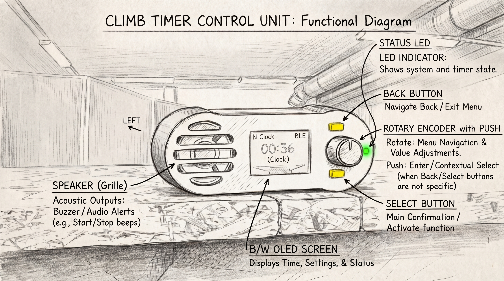

# T2Climb Timer — Climber's User Guide

Welcome to the **T2Climb Timer User Guide**! Designed for climbers, coaches, gyms, and route-setters, T2Climb makes running interval training, mock competitions, and IFSC-format speed and lead climbing effortless.

---

## ⚡ 1-Minute Quick Start

### 1. Power On the Timer
Plug the T2Climb Station into any USB-C power source or battery pack. The OLED screen boots up and shows the default screen.

### 2. Connect Your Phone
Open the T2Climb Web App on your smartphone:
- Tap **Connect via Bluetooth** to pair instantly without any Wi-Fi passwords, or
- Connect to the station's Wi-Fi network and tap **Connect via WiFi**.

### 3. Pick Your Discipline & Go!
Select your exercise from the top selector or on the station's knob:
- ⚡ **[Speed Climbing (Nopeuskiipeily)](speed.md)**: Official IFSC 15m speed timing, false-start detection, top pad registration.
- 🧗 **[Boulder](boulder.md)**: Timed climb and rest rotation intervals, automated beeps, 1-minute warning tones.
- 🧗‍♂️ **[Lead](lead.md)**: 40-second prep window, silent 6-minute climbing countdown, timeout warning buzzers.
- 🏋️ **[Intervals & Circuits (Intervallit)](circuit.md)**: Custom hangboard repeaters, 4x4s, and continuous endurance circuits.
- ⏱️ **[Clock & Stopwatch](clock.md)**: Count-up gym stopwatch, dual split timing, and wall clock.

---

## 🧭 Navigating the Guides

- **[Climbing Disciplines & Modes](speed.md)**: Quick-start guides explaining how each discipline works, how to configure intervals, and what the timer beeps mean.
- **[Web App & Remote Control Guide](Web-UI-Guide.md)**: Complete guide to controlling the timer from your smartphone or tablet.
- **[Hardware Station & Physical Controls](Hardware-Guide.md)**: Button functions, rotary knob menu, and OLED status screens on the physical timer box.
- **[Technical & Protocol Reference](Technical-Reference.md)**: *(For developers and engineers)* Protocol commands, G-code syntax, and event API specs.
